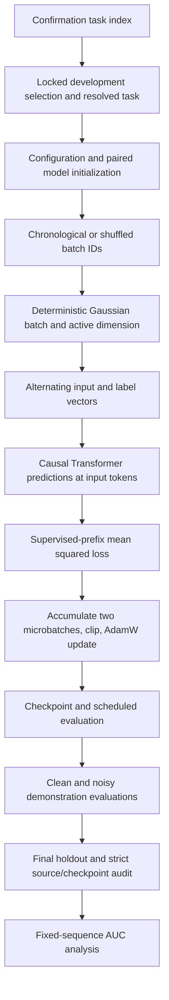

# How the confirmed experiment works

This describes the actual confirmation path, using the frozen source and resolved tasks. Each link below points to the implementing function. Source files are unchanged; this walkthrough is documentation added after the runs.

## Execution path



## 1. Resolve the configuration actually used

[confirmation_experiment.py: `main`](../experiments/confirmation_20261008/confirmation_experiment.py#L53) calls [confirmation_experiment.py: `tasks`](../experiments/confirmation_20261008/confirmation_experiment.py#L49) and [confirmation_experiment.py: `task_config`](../experiments/confirmation_20261008/confirmation_experiment.py#L32). Development tasks come from the frozen plan. Confirmation tasks come from the recorded optimizer selection and the resolved 60-task list, checked by [confirmation_plan.py: `load_selection`](../experiments/confirmation_20261008/confirmation_plan.py#L133).

Confirmation is 20 seeds (1000..1019), each with curriculum, shuffled and full difficulty. Each task uses 50 dimensions, 101 prediction positions, 125k updates, batch 256/microbatch 128, 12 layers, width 256, eight heads, and BF16. The winning shared development configuration is LR 0.0001 with raw loss. Calling `run_experiment.py --preset full` alone selects older defaults and does not reproduce this study.

The adapter also replaces the trainer's identity callback with [confirmation_experiment.py: `identity`](../experiments/confirmation_20261008/confirmation_experiment.py#L15), attaching hashes of the source, protocol, task list, source freeze and recorded selection to every model/checkpoint/evaluation. The batch and update functions remain the same trainer implementation.

## 2. Create paired starting parameters

[run_experiment.py: `seed_model`](../experiments/confirmation_20261008/run_experiment.py#L164) seeds Python, Torch and CUDA before constructing the model. All three strategies for one training seed have the same architecture and initial parameter fingerprint. Deterministic algorithms are enabled, TF32 is disabled and dropout is zero. A different software/hardware stack is not guaranteed to reproduce every floating-point bit.

## 3. Choose batch order and task difficulty

[robustness_experiment.py: `batch_order`](../experiments/confirmation_20261008/robustness_experiment.py#L84) returns batch IDs. Curriculum and full difficulty use IDs in ascending order. Shuffled permutes IDs 0..24,999 using its own generator seeded with `training_seed + 9000003`; IDs 25,000 onward stay chronological.

[robustness_experiment.py: `canonical_dims`](../experiments/confirmation_20261008/robustness_experiment.py#L73) determines the scheduled dimension from **batch ID**, not the current optimizer step. For batch ID b:

```text
if b < 1000:      d(b) = 5
if 1000 <= b < 25000:
                  d(b) = 5 + floor(45 * (b - 1000) / 23999)
if b >= 25000:   d(b) = 50
```

For curriculum/shuffled, active dimension is d(b), the number of supervised prediction positions is 2d(b)+1, and target scale is sqrt(50/d(b)). Full difficulty uses active dimension 50, all 101 supervised positions and scale 1 from the start. This is implemented in [robustness_experiment.py: `treatment`](../experiments/confirmation_20261008/robustness_experiment.py#L98). Physical arrays always retain 50 coordinates and 101 positions. Only active input coordinates and supervised loss positions change.

## 4. Generate exactly the same batches under reshuffling

[robustness_experiment.py: `generator`](../experiments/confirmation_20261008/robustness_experiment.py#L92) creates separate CPU generators from a SHA256 hash of `dimension_batch_v1|training_seed|batch_id|stream`, where stream is `tasks` or `inputs`. Thus regenerating a particular batch does not depend on which batches preceded it.

[robustness_experiment.py: `batch`](../experiments/confirmation_20261008/robustness_experiment.py#L106) samples one latent Gaussian weight vector per episode and Gaussian inputs with shapes:

```text
weights: [256, 50, 1]
inputs:  [256, 101, 50]
labels:  [256, 101]
```

It zeros inactive input coordinates and computes clean labels `(inputs @ weights) * sqrt(50/active_dimension)`. Expected target variance therefore stays 50 at every difficulty. Training adds no label noise.

For curriculum and shuffled, the same seed and batch ID reconstruct identical inputs, labels, scale and loss mask. Their first 25k batches differ only in order. All three strategies share the same full-difficulty batches after that boundary. Full difficulty has different early exposure, so it does not isolate temporal ordering.

## 5. Turn numeric examples into a causal sequence

[run_experiment.py: `RegressionTransformer`](../experiments/confirmation_20261008/run_experiment.py#L141) creates a new GPT-2-style Transformer. It does not load pretrained language-model weights or tokenize text.

`forward()` represents each label as a 50-dimensional zero vector with the label value in coordinate 0. It alternates input and label vectors:

```text
[x_0, label(y_0), x_1, label(y_1), ..., x_100, label(y_100)]
```

The 202 vectors are projected linearly from 50 to 256 dimensions and passed as `inputs_embeds` to `GPT2Model`. GPT-2 supplies positional embeddings and causal attention. Its ordinary vocabulary embedding lookup is bypassed; the numeric input projection is the embedding route used here. A final linear projection produces scalar predictions, retaining only even token positions `0::2`.

The prediction for x_k can see k preceding demonstration labels. The token carrying its own label is later in the causal sequence and cannot affect it. Although all labels are physically present in the full tensor, own and future labels are masked from that prediction. This is checked through future-target mutation and an independent forward pass in which the query target is absent.

## 6. Compute loss and update parameters

[robustness_experiment.py: `training_objective`](../experiments/confirmation_20261008/robustness_experiment.py#L115) computes mean squared error over examples and only the first `eligible = 2*active_dimension+1` prediction positions for curriculum/shuffled, or all positions for full difficulty:

```text
raw_loss = mean((prediction.float()[:, :eligible] - labels[:, :eligible]) ** 2)
```

This includes the k=0 prediction, which has no demonstrations. Later predictions are excluded from that batch's loss during low difficulty. They do not influence earlier predictions because attention is causal. The physical forward pass still covers the full sequence.

All confirmation tasks use the raw-loss setting. The alternative development `nmse` setting divides that loss by active dimension; it is not selected for confirmation.

[robustness_experiment.py: `train`](../experiments/confirmation_20261008/robustness_experiment.py#L221) splits each batch into two microbatches of 128. Each microbatch loss is divided by two before backpropagation, so gradients accumulate for one effective batch of 256. The model forward uses CUDA BF16 autocast, while predictions are converted to FP32 for loss. After accumulation, gradients are clipped to norm 1 and AdamW takes one update (LR 0.0001, weight decay 0.01). Each batch ID corresponds to one optimizer update, not one microbatch update.

## 7. Save and resume the exact treatment

[robustness_experiment.py: `save`](../experiments/confirmation_20261008/robustness_experiment.py#L154) stores model parameters, optimizer state, completed updates, batch IDs and Python/Torch/CUDA RNG states. [robustness_experiment.py: `load`](../experiments/confirmation_20261008/robustness_experiment.py#L160) refuses identity or schedule mismatches and verifies optimizer progress before restoring state. The saved schedule also records dimension, supervised positions and scales at every step. Retained checkpoint copies are made at evaluation updates; termination signals request a save after the current update.

The archive contains text manifests, training logs and checkpoint checksums. The checkpoint binaries and binary schedules remain on IDUN. CPU and recorded GPU smoke tests checked restart behavior; their reports are retained.

## 8. Evaluate on full-dimensional unseen tasks

[robustness_experiment.py: `evaluation_bank`](../experiments/confirmation_20261008/robustness_experiment.py#L175) uses [run_experiment.py: `EpisodeStream`](../experiments/confirmation_20261008/run_experiment.py#L115) to draw full 50-dimensional Gaussian tasks from separate task/input/corruption generators. The confirmation primary bank is seed 731841 and final holdout is 731842; each contains 4,096 episodes. Development uses distinct banks 731839/731840.

[robustness_experiment.py: `evaluate`](../experiments/confirmation_20261008/robustness_experiment.py#L179) supplies clean labels plus Gaussian noise of raw SD 0, 1 or 2 as demonstration context. It scores predictions against **clean** targets through [run_experiment.py: `clean_target_losses`](../experiments/confirmation_20261008/run_experiment.py#L304). Query labels cannot leak through the later label token. One normalized loss is obtained for each episode and k; averaging over episodes produces the 101-value curve. The reported late-context scalar averages all episode errors for k=50..100, divided by 50.

The same bank and corruption draws are reused across strategies and checkpoints. Evaluation captures/restores the training RNG and model mode, so it does not alter the next training update. The final holdout is evaluated after all 125k updates.

## 9. Select and analyze without mixing cohorts

[confirmation_analysis.py: `development_selection`](../experiments/confirmation_20261008/confirmation_analysis.py#L105) ranks each optimizer's mean clean AUC over the three development seeds. Shuffled's winner becomes the common curriculum/shuffled setting; full difficulty uses its own grid winner. Holdout and confirmation outcomes are excluded from selection.

[confirmation_analysis.py: `validate_cohort`](../experiments/confirmation_20261008/confirmation_analysis.py#L38) checks source/identity, model initialization, every recorded schedule, checkpoint hashes, AdamW progress, training logs, metric banks and holdouts. It needs the checkpoint binaries; the repository's standard-library archive check verifies shipped identities/metrics and preserves the original binary-audit report, rather than repeating that unavailable binary audit.

[confirmation_analysis.py: `confirmation_summary`](../experiments/confirmation_20261008/confirmation_analysis.py#L129) computes each model's trapezoidal mean clean error over updates 25k..125k, then delegates to [confirmation_plan.py: `analyze_scores`](../experiments/confirmation_20261008/confirmation_plan.py#L185). The fixed-sequence sign tests and observed-effect requirements were frozen before confirmation. See [results.md](results.md) for the result and its outlier sensitivity.

`analysis/recompute_review.py` independently recomputes scalar outcomes from shipped raw metrics and checks the original summary. Its ratios, signed-rank tests and peak-ratio comparisons are explicitly post hoc. `analysis/make_review_figures.py` plots recorded curves; `tools/reproduce_results.py` runs the archive/reanalysis checks and prints a compact reader-facing summary.
