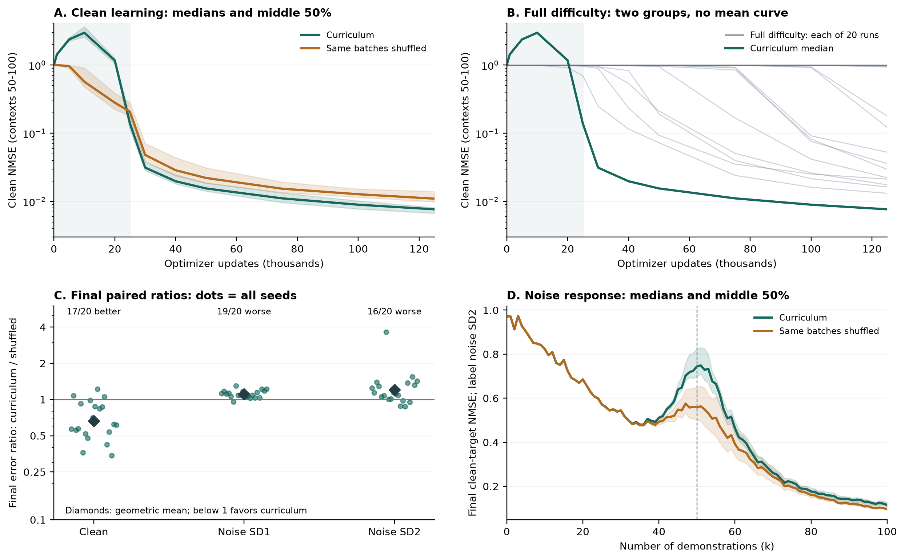

# Results and where every number comes from

The main observation is a **clean-accuracy / noisy-demonstration trade-off** against the exact same-batches-reshuffled control. All models were trained on clean data. These are results from 20 paired training seeds, not a general proof about all curricula or language models.

## Final checkpoint: clean and noisy evaluations

All rows measure mean clean-target squared error divided by 50, averaged over demonstration counts k=50..100, on the primary 4,096-task bank at 125,000 updates. Lower error is better. Noise is added to demonstration labels in raw units; the target used for scoring remains clean.

| Evaluation condition | Curriculum mean | Shuffled mean | Curriculum better | Curriculum worse |
| --- | ---: | ---: | ---: | ---: |
| Clean | 0.00772672 | 0.01207869 | 17/20 | 3/20 |
| Gaussian label noise SD1 | 0.08043591 | 0.07244670 | 1/20 | 19/20 |
| Gaussian label noise SD2 | 0.32529109 | 0.26421095 | 4/20 | 16/20 |

The independent final evaluation bank repeats these win/loss counts. It evaluates the same models, so it is not a second cohort of independently trained models.

Final clean error's geometric mean paired curriculum/shuffled ratio is **0.664634**; removing seed 1017 descriptively gives **0.688213**. This averages the log of each seed's ratio, then exponentiates. It is different from dividing the two arithmetic arm means, which gives 0.639699. These ratios were added after observing results.

## Prespecified clean learning-curve comparison

AUC here means the trapezoidal average of late-context clean NMSE over updates 25k,30k,40k,50k,75k,100k,125k. It retains NMSE units; it is not the final error or an unnormalized integral.

| Strategy | Arithmetic mean clean AUC |
| --- | ---: |
| Curriculum | 0.01751468 |
| Same batches shuffled | 0.04321429 |
| Full difficulty | 0.73246069 |

Curriculum versus shuffled: **16/20** AUC wins, two-sided exact sign-test **p=0.01181793**, mean paired reduction **0.02569962**, median reduction **0.00747756**. Clean final error instead has 17/20 wins: the two counts refer to different endpoints.

The frozen analysis tested curriculum versus full difficulty first, then ordering versus shuffled. Each required p<0.05, observed mean AUC reduction at least 0.02, and curriculum final mean at most 0.25. Both passed. This protocol was locally frozen before the new outcomes, not externally preregistered.

**Outlier sensitivity:** seed 1017 supplies 69.3% of the aggregate ordering gain. Excluding it post hoc gives mean reduction 0.00831781, below the original 0.02 minimum. The original analysis retains all 20 seeds. Typical gains are smaller than the arithmetic mean suggests. Added Wilcoxon tests and ratio analyses are exploratory and do not replace the original decision rule.

## Full-difficulty baseline

The overall final mean is 0.51714589, but the runs split into two groups:

| Final outcome | Seeds | Mean NMSE | Median NMSE | Range |
| --- | ---: | ---: | ---: | --- |
| Learned: final NMSE <=0.25 | 10/20 | 0.05093443 | 0.02591659 | 0.013193–0.178576 |
| Did not learn | 10/20 | 0.98335735 | 0.99004012 | 0.938615–0.997522 |

Eleven of twelve full-difficulty development runs had AUC near 0.996, and its selected learning rate was the lowest tested. This baseline does not establish an optimal full-difficulty comparison. The shared setting chosen using shuffled development scores ranked third for curriculum on its own development data. The exact shuffled-batch comparison is the main ordering evidence.

## Figures



A shows median clean curves with seed interquartile bands; B shows every full-difficulty trajectory; C shows every paired final error ratio; D shows the SD2 noise-response curve. Bands describe variation across seeds, not confidence intervals.

At SD2, curriculum has a stronger error peak around the task dimension. Weaker implicit regularization is a hypothesis for follow-up. Fragile fitted-ridge values and unverified reference overlays are omitted.

## Reproduce and inspect

From the repository root:

```bash
python3 tools/reproduce_results.py
```

This first verifies source, raw archive and run identities, then recomputes scalar outcomes from the raw metric JSONs, checks them against the original summary, and prints the main tables. Fresh output is written to `artifacts/review_recomputed.json` and `artifacts/repository-verification.json`.

| Evidence | File |
| --- | --- |
| Every model and condition | [all_seed_results.csv](../reports/confirmation/all_seed_results.csv) |
| Every paired ordering contrast | [paired_curriculum_vs_shuffled.csv](../reports/confirmation/paired_curriculum_vs_shuffled.csv) |
| Original prespecified analysis | [summary.json](../reports/confirmation/summary.json) |
| Added exploratory analyses | [REVIEW_AUDIT.json](../reports/confirmation/REVIEW_AUDIT.json) |
| Raw metrics, manifests, logs and selection | [confirmation_20261008.zip](../data/confirmation_20261008.zip) |
| Figures and sensitivity review | [two-page brief](../reports/confirmation/icl_curriculum_results_for_srikar_v2.pdf) |

For GPU training reproduction, see [reproduction.md](reproduction.md). For the exact calculation path, see [code_walkthrough.md](code_walkthrough.md).
